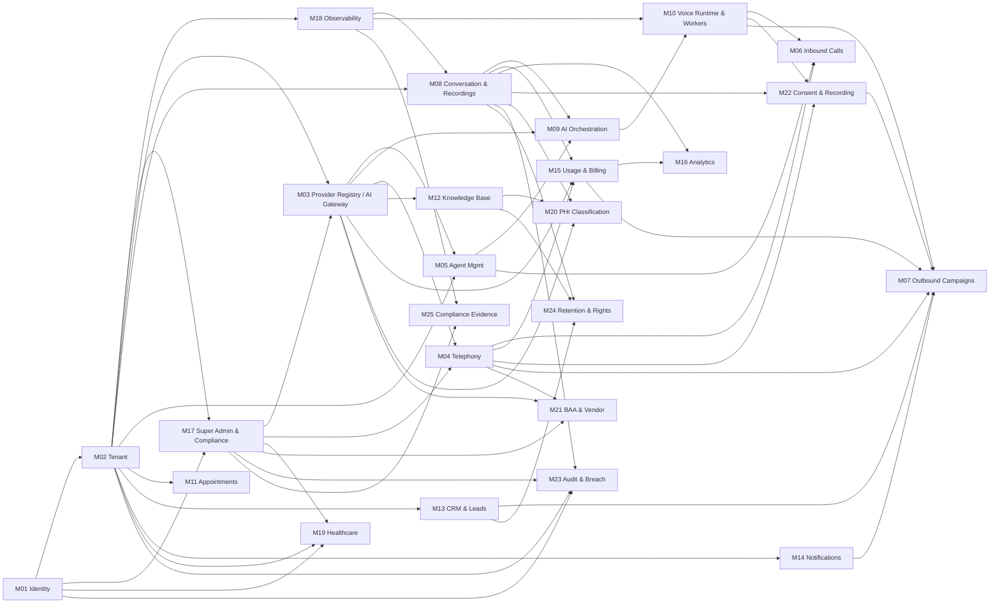

# Module Dependency Graph

| Field | Value |
|---|---|
| Source | Addendum §P (ADD-P-02), CR-017; LLD v1.3 §2 for M19–M25 |
| Module IDs | [Module catalogue](../architecture/module-catalogue.md). M01–M18 are provisional (CR-001) |
| Status | Draft |

**Hard** dependency: the module can't pass *Design* until the dependency is Done.
**Soft** dependency: work can start, but the feature that needs it stays off until the dependency is Done.
For M19–M25, the dependencies are exactly as LLD v1.3 states them.

## Graph

Soft dependencies (not drawn): M05 → M12 (KB bindings) and M05 → M09 (tool grants); M10 → M04 (SIP channel);
M09 → M11/M13/M14 (business tools); M06 → M11 (business hours/holidays).

## Cycle found in the LLD: M07 ↔ M22

LLD v1.3 lists **M22 Consent & Recording depends on M07 Outbound Campaigns**, but outbound campaigns can't
run without consent checks (ADD-I-04), so M07 depends on M22. That's a cycle.

**Proposed fix (part of CR-011):** split it in two.

- **M22-core:** consent records, notice playback and recording modes for all tenants. It depends on M04, M08 and M10, and it's built before M07.
- **M22-outbound:** campaign-specific consent evidence and suppression links. It's built together with M07.

The graph above shows the proposed order (M22 before M07). It needs approval before M07 starts.

## Build waves

| Wave | Modules | Exit gates (addendum §O / LLD §12) | Plan step |
|---|---|---|---|
| W0 Foundation | M01, M02, M17 (audit core), M18 (CI, logging, tracing base) | O16 core isolation (API, SQL, RLS, jobs); secure login and tenant setup | Step 3 |
| W1 Voice core config | M03 (STT/LLM/TTS adapters + mocks), M05, M08 | Immutable agent versions; adapter contract tests | Step 4 |
| W2 Common voice engine (browser channel) | M09, M10 | O1, O4, O5, O14; O15 measured (target not yet claimed) | Step 4 |
| W3 Telephony and inbound | M04, M06, M12 | O2, O6, O8, O9, O10 | Later |
| W4 Business tools and billing | M11, M13, M14, M15 | O7, O10, O12 | Later |
| W5 Outbound and consent | M22-core, M07 (+ M22-outbound), M16 | O3, O11, O13 | Later |
| W6 Healthcare mode | M19, M20, M21, M23, M24, M25 | HC-001 … HC-012; LLD §16 release checklist | Later |

W3 can run in parallel with W2 once W1 is Done, because M04 doesn't depend on M09 or M10.
